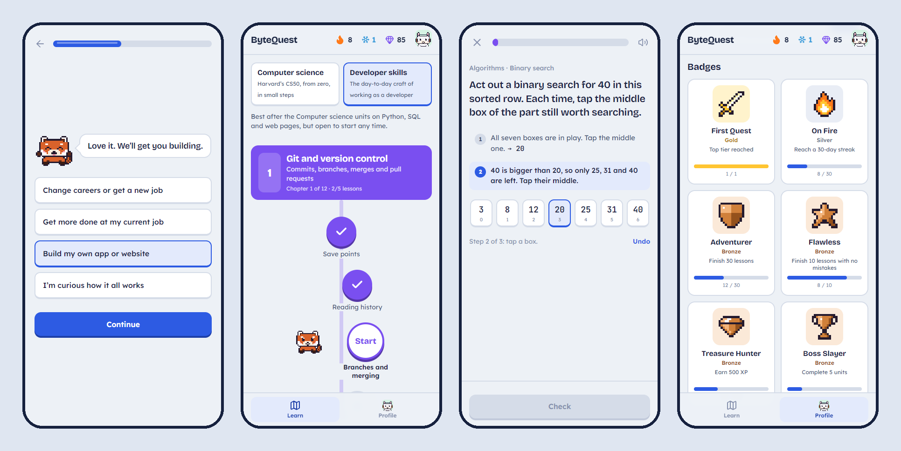

# ByteQuest: learning to code as a daily habit

ByteQuest teaches people who have never coded, a few minutes a day. It takes the content of Harvard's CS50 and delivers it the way a habit app would: short lessons, a streak, a mascot, and reminders that respond to how each learner is doing. It is a working prototype that runs entirely in the browser.

**[Try the live demo](https://josephfanpm.github.io/Learntocode/)**



This is an independent portfolio project. It is not affiliated with or endorsed by Harvard, CS50 or any other learning app. There are no real learners yet, so there are no usage numbers here.

## At a glance

| | |
|---|---|
| **Problem** | The best free way to learn computer science is a university course built from long lectures and multi-hour problem sets. People with jobs and no background start it and stop. |
| **User** | An adult with no coding experience who wants to change careers, get more done at work, build something, or understand how technology works, and has minutes a day rather than hours. |
| **Solution** | CS50's full arc, rewritten as 107 three-minute lessons with real code that runs in the browser, wrapped in a habit loop: streaks, a daily goal, a placement quiz, and reminders timed to when the learner usually practices. |
| **Result** | A working prototype: 13 units, 1,038 exercises, 21 tests on the streak, unlock, reminder, badge and save logic, and a checker that runs every code exercise's answer. No real-world result: nobody has been measured using it. |
| **My role** | Product and build: the problem, the course structure, the habit and reminder rules, the trade-offs, and the prototype. |

## Problem

CS50 is one of the most popular introductions to computer science, and it is free. It is also built for students: each week is a lecture of about two hours, plus a problem set that can take an evening or a weekend. That shape works in a semester. It works less well for someone fitting learning around a job.

| What a beginner runs into | Why it stops them |
|---|---|
| A two-hour lecture before writing any code | There is no small first win, and no natural place to stop and come back. |
| Installing and configuring tools | The first error message arrives before the first lesson. |
| A blank editor and a long assignment | Without small steps, getting stuck early means not starting. |
| No reason to return tomorrow | Nothing marks progress day to day, so one missed week becomes the end. |

Language-learning apps solved the same shape of problem with short sessions, immediate feedback and a streak. ByteQuest asks what CS50 looks like with that treatment.

<!-- TODO(Joseph): add real evidence for the problem if you have it (online course completion rates, conversations with people who started and stopped a coding course). None is claimed here. -->

## Target users

- **Career changers and upskillers** who want real programming ability, not a toy, and can give it a few minutes on most days.
- **Curious non-technical people** who use software and AI at work and want to understand what is underneath.
- **People who have coded before** are served by the placement quiz, which lets them skip what they already know.

<!-- TODO(Joseph): no user research was done for this prototype. Add any conversations with learners here if you have them. -->

## Solution

- **The whole of CS50, in small steps.** Thirteen units follow the course week by week, from binary to web apps, AI, cybersecurity and a final project. Each unit covers that week's lecture ideas and the ideas behind its labs and problem sets, rewritten as original lessons of 7 to 10 exercises.
- **Real code, no setup.** Python and SQL run in the browser tab, and web pages are checked as they are built. A program that loops forever is stopped after six seconds, and error messages are rewritten as one plain sentence.
- **Ten kinds of exercise.** Beyond multiple choice: put lines in order by dragging, match pairs, fill gaps, write code, tap the line with the bug, flip switches to make a binary number, act out an algorithm by tapping the box it would check next, and type what a program prints.
- **Setup that ends in a lesson.** Pip, the mascot, asks one question per screen. The first lesson comes before any profile details; name and avatar are asked after it and can be skipped.
- **A placement quiz instead of "have you coded before?"** One question per unit, easiest first. Each right answer skips a unit; the first miss ends the quiz.
- **A habit loop.** A daily streak, streak freezes for missed days, a daily goal, lessons that unlock in order, and wrong answers that come back at the end of the lesson.
- **Reminders that adapt.** In-app banners, browser notifications and email (simulated) come from one set of rules that read the learner's activity. See below.
- **A character.** Pip is a pixel-art red panda who reacts to answers, and every learner gets a pixel-art avatar in the same style.
- **Badges that level up.** Six pixel-art badges (sword, flame, shield, star, gem, trophy) climb from bronze to silver to gold, each with a progress bar toward the next tier.
- **Progress that can be kept.** Progress lives in the browser; a backup file or a save code moves it to another device.

### The course

| Unit | CS50 week | Topics | Labs and projects |
|---|---|---|---|
| 0 | 0 (Scratch) | Binary; text, colour, images and sound as numbers; algorithms | Design a program |
| 1 | 1 (C) | Print, variables, input, decisions, loops, functions; compiling, types and their limits, the command line | Pyramids and coins; checksum |
| 2 | 2 (Arrays) | Lists and text, debugging, arguments | Word scores and reading level; ciphers |
| 3 | 3 (Algorithms) | Searching, sorting, big O, recursion, records, merge sort | Run an election; which sort is this? |
| 4 | 4 (Memory) | Hexadecimal, names and values, copying, files, pointers, memory care, images | Sound volume and lost photos |
| 5 | 5 (Data structures) | Stacks, queues, linked lists, hash tables, trees, tries | Family tree; spell checker |
| 6 | 6 (Python) | Dictionaries, formatting, errors, comprehensions, CSV, classes, libraries | DNA detective |
| 7 | 7 (SQL) | Queries, grouping, joins, subqueries, table design | Music library; a mystery solved with queries |
| 8 | 8 (HTML, CSS, JavaScript) | How the internet works, pages, forms, styling, layout, interactivity | Homepage; quiz page |
| 9 | 9 (Flask) | Routes, forms, templates, sessions, APIs, accounts and passwords | Birthday book; play-money stock trader |
| 10 | AI | Learning from examples, game search, training and testing, how chatbots write, prompts | |
| 11 | Cybersecurity | Passwords, hashing, encryption, staying safe | |
| 12 | Final project | Scope an idea, then build, save, test and share a habit tracker | The project itself |

### How the habit loop works

| Mechanic | Rule |
|---|---|
| Streak | Counts the learner's own calendar days. A day stays alive until midnight. |
| Streak freeze | Covers a missed day. Start with 1, hold up to 2, buy more with gems. Freezes are only spent when they cover the whole gap. |
| XP and daily goal | 10 XP for a new lesson, 5 for a repeat, 5 more for a perfect one. Goals are 10, 20, 30 or 50 XP a day. |
| Unlocks | Lessons open in order; finishing a unit opens the next. |
| Mistakes | A wrong answer returns at the end of the lesson. Code exercises allow retries, with the answer offered after two misses. |

### How reminders decide what to send

Twenty rules read a snapshot of the learner: streak, days away, progress toward today's goal, wrong answers in the current lesson, and why they signed up.

| Channel | Examples |
|---|---|
| In-app | First lesson, a freeze saved your streak, your streak ended (fresh start), welcome back with a review, stuck on a lesson, unit finished, streak milestones, close to the daily goal |
| Push | Streak at risk, a late streak saver, first lesson not started, a few days away |
| Email (simulated) | Welcome, weekly recap, one week away, two weeks away (suggests a smaller goal), thirty days away (the last message) |

- **Timing.** The daily reminder is due about 23.5 hours after the learner's last lesson, kept between 8am and 8pm. If a streak of three or more days is still at risk at 8pm, one streak saver follows.
- **Wording.** The streak reminder rotates through several messages and never repeats the previous day's.
- **Limits.** Each message is sent once. One daily reminder, one email every three days, nothing overnight. Push hands over to email after a week away, and after thirty days the learner hears nothing until they return.

This is a static site, so notifications only arrive while the tab is open and email is not actually sent. A production version would run the same rules on a server.

## My role

I built ByteQuest with Claude Code as a pair programmer. I set the product direction: basing the course on CS50, the habit mechanics, placing learners with questions rather than asking about experience, asking for profile details only after the first lesson, giving every learner a starting avatar, timing reminders to when people actually practice, the pixel-art direction for the mascot, and what to cut. I reviewed the prototype screen by screen and directed the changes.

<!-- TODO(Joseph): confirm this matches what you'd say in an interview, and add a line on your background if you want it here. -->

## Key decisions and trade-offs

| Decision | Options | Chose | Gave up | Why |
|---|---|---|---|---|
| **What to teach** | Write a new curriculum · follow an established course | Follow CS50 week by week | Freedom to reorder or drop hard topics | A known syllabus gives beginners a credible destination, and the hard topics (memory, algorithms) are what make it real. |
| **Teaching language** | C, as CS50 does · Python throughout | Python, with C shown in read-only snippets where the idea needs it | Hands-on C: learners read pointers and memory management but do not write them | Python runs in a browser tab and gets out of a beginner's way. Installing a C toolchain is where many people stop. |
| **Lesson size** | Lecture-length · one idea per three-minute lesson | Three minutes, 7 to 10 exercises | Depth in a single sitting | A habit needs a session that fits in a spare moment, and a clear place to stop. |
| **Labs and problem sets** | Skip them · copy them · rebuild the ideas in small steps | Original lab lessons that build the same ideas step by step | The open-ended struggle of a blank file, which is where some learning happens | A beginner with ten minutes cannot start a four-hour assignment. Scaffolded steps keep them moving; the final project hands back the blank page. |
| **Where to start a learner** | Ask how experienced they are · test them | A placement quiz, one question per unit | A few seconds of setup, and precision: one question per unit is a coarse test | People misjudge their own level in both directions. A question they can or cannot answer is better evidence. |
| **When to ask for a profile** | During setup · after the first lesson | After the first lesson, skippable | Knowing the learner's name from the start | Every screen before the first lesson loses people. A profile is easier to ask for once they have finished something. |
| **Avatar** | Empty until made · build one during setup · assign one at random | Random pixel avatar for everyone, customisable later | A deliberate first choice | Nobody starts with a blank placeholder, there is no extra step, and people are more likely to adjust something they were given. |
| **Reminder time** | Learner picks a time · remind when they usually practice | About 23.5 hours after the last lesson, with no time setting at all | The learner's control over the time | A time someone picks is a guess about their day. The time they practiced yesterday is something they already did. |
| **Streak freezes** | No protection · spend a freeze per missed day · spend only when it saves the streak | Only when freezes cover the whole gap | Simplicity | A streak with no forgiveness punishes one bad day. Burning freezes on a streak that is lost anyway is a second punishment. |
| **Lapsed learners** | Remind forever · stop at some point | Push for a week, then email, then silence after thirty days | Some learners who would have come back on day 45 | Messages nobody acts on train people to ignore the app, or to turn everything off. |
| **Wrong answers** | Hearts that run out · no penalty | No hearts: the question returns at the end, and the wrong sound is soft | The tension that scarcity creates | Beginners are wrong a lot. Locking them out for mistakes punishes the thing learning requires. |
| **Exercise formats** | Multiple choice only · add hands-on formats | Ten formats, including drag, tap-the-bug and step-through | Content cost: each new format needs its own authoring and checking | Recognising an answer is weaker than producing one. Debugging and tracing are skills in their own right. |
| **Mascot** | None · smooth vector character · pixel art | A pixel-art red panda with seven moods | The fluid motion of a rigged character | A character makes feedback feel like it comes from someone. Pixel art suits the subject, animates frame by frame in code, and is cheap to extend to learner avatars. |
| **Sound** | None · licensed pack · made in code | Original chip-style sounds made in code; the right-answer sound climbs with each answer in a row | The polish of studio-made effects | Sound marks the moments that matter. Making it in code keeps it original, free of licences, and matched to the art. |
| **Saving progress** | Accounts and a server · browser only · browser plus export | Browser storage with a backup file and a save code | Automatic sync across devices | A prototype with no server has nothing to breach and nothing to run. The save code covers moving devices without an account. |
| **Getting around** | Links in the top bar · bottom tabs | Two bottom tabs: Learn and Profile | Screen height on small phones | From the profile there was no obvious way back to the lessons. Tabs make both places one tap away and always visible. |
| **Internal tooling in the app** | Keep a page that simulates which reminders each kind of learner gets · remove it | Removed | A visible demonstration of the reminder rules | It was a tool for the builder, not something a learner needs. The rules and their tests remain. |

## What is not here

- **No real learners or results.** Whether this keeps people learning is untested.
- **No accounts or sync.** Progress stays in the browser unless exported.
- **No real push or email delivery.** The rules run; a server would be needed to deliver when the app is closed.
- **Simplified assignments.** Some CS50 problem sets are reduced (a one-row blur instead of a full image filter) and the hardest election method is left out. Flask and live web requests are shown, not run.
- **No leagues, friends or leaderboards.**

## Run it

```sh
npm install
npm run dev        # http://localhost:5173
npm test           # streak, unlock, reminder, badge and save tests
npx tsx scripts/check-content.ts   # validates every exercise; runs each Python and SQL answer against its tests
```

Settings (the gear icon on the profile) has a **Prototype: unlock all lessons** switch, off by default. Any exercise can be opened directly with `#/lesson/<lesson-id>?at=<index>`, which does not save progress.

Built with Vite, React, TypeScript and Tailwind. Python runs in [Pyodide](https://pyodide.org) inside a Web Worker and SQL in [sql.js](https://sql.js.org). Pip, the avatars and the sounds are generated in code: sprites as pixel grids ([src/ui/pixel/sprites.ts](src/ui/pixel/sprites.ts)), sounds with the Web Audio API ([src/sound.ts](src/sound.ts)). The reminder rules are in [src/engine/messaging.ts](src/engine/messaging.ts).

## Credits and licence

The course structure follows CS50x by David J. Malan and Harvard University, whose materials are licensed [CC BY-NC-SA 4.0](https://creativecommons.org/licenses/by-nc-sa/4.0/). The lessons here are original writing. Lesson content in `src/content/` is shared under the same CC BY-NC-SA 4.0 licence.
